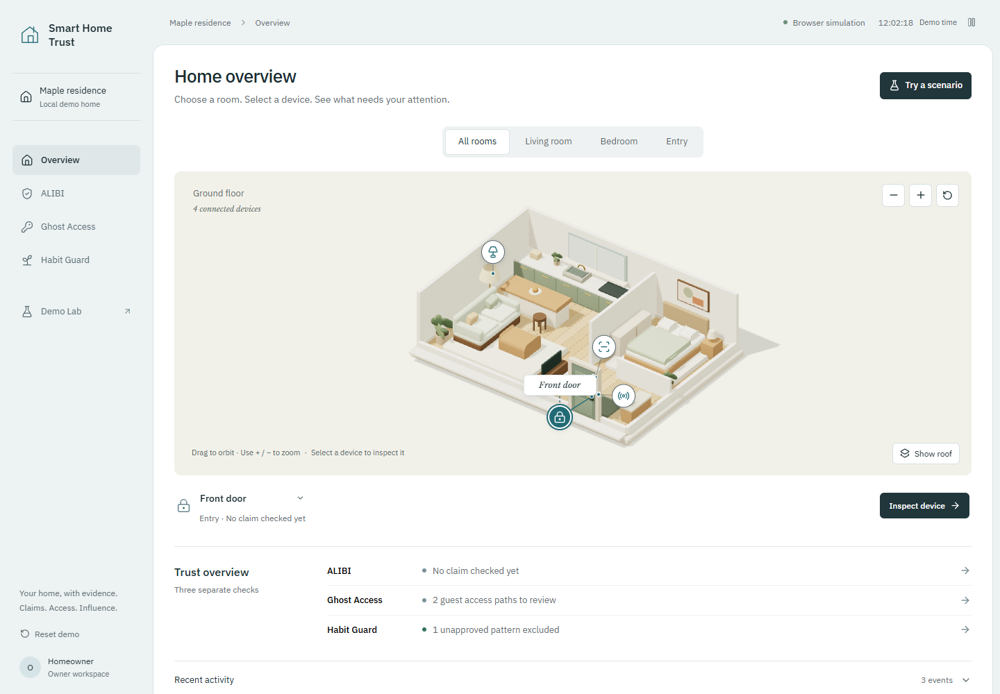

# Smart Home Trust

[](https://github.com/Maximus0714/smart-home-trust/actions/workflows/ci.yml)

A local frontend demonstration of three separate trust decisions in a smart home: **ALIBI** checks device claims, **Ghost Access** checks control paths, and **Habit Guard** checks whose activity may teach routines.



## Project status

Working frontend prototype for a software-only smart-home security demonstration. All devices, access decisions, credentials, and witness readings are simulated in the browser. No real devices are connected.

| Area | Implemented |
| --- | --- |
| Interactive home | Furnished procedural 3D house, room focus, orbit/zoom, removable roof, animated door/bolt/light, accessible icon pins and device inspector. |
| ALIBI | Command-bound witness qualification, supported/contradicted/insufficient verdicts, replay/delay/missing-evidence scenarios, expiry, and evidence history. |
| Ghost Access | One seeded guest and integration, independent access paths, direct/full removal, credential rotation, and allowed/denied light requests. |
| Habit Guard | Seven-day pattern comparison, source-based teaching eligibility, proposal provenance, approval and daily scheduling, isolated baseline light. |
| Demo Lab | Eight repeatable scenarios, editable simulator inputs, time controls, and reset. |
| Browser support | Local persistence, responsive desktop/phone layouts, reduced motion, keyboard controls, and a usable home-plan alternative if WebGL fails. |

**Planned, not implemented:** multiple named guests/integrations, add/re-add controls, configurable per-device/action grants, and constrained delegation. The proposed [access-lifecycle design](docs/superpowers/specs/2026-10-24-access-lifecycle-design.md) records those decisions; it is not a description of current functionality.

## Run

Node.js 22.12 or newer is required; this project was verified with Node.js 24.

```powershell
git clone https://github.com/Maximus0714/smart-home-trust.git
cd smart-home-trust
npm ci
npm run dev
```

Open the local address printed by Vite, normally [http://127.0.0.1:5173](http://127.0.0.1:5173).

Repository access is required while the repository is private. After the initial dependency installation, the app needs no API keys, environment variables, account login, or external device service. Node.js 24 is selected in `.nvmrc` and in CI.

## Stack and checks

React 19, TypeScript, Vite 8, Three.js, React Three Fiber 9, drei 10, lucide-react, locally served Fontsource fonts, and Vitest. Dependency versions are locked in `package-lock.json`.

| Command | Purpose |
| --- | --- |
| `npm run dev` | Start the local development server. |
| `npm run typecheck` | Run strict TypeScript checks. |
| `npm test` | Run the focused simulation and persistence tests. |
| `npm run build` | Type-check and produce `dist/`. |
| `npm run preview` | Serve the production build locally. |

```powershell
npm run typecheck
npm test
npm run build
npm run preview
```

The production build is written to `dist/`. The preview command serves that build locally, normally on port 4173. No hosting account or external service is required.

GitHub Actions runs the type checks, tests, and production build on pushes to `main` and on pull requests. It does not deploy the website.

## Five-minute demo

1. On Overview, select an icon pin, inspect a device, move the door or toggle the light, and explore the rooms.
2. In Demo Lab, run **A false lock report**, then advance **+3 seconds**. Inspect ALIBI's contradiction and evidence; an unavailable witness instead produces insufficient evidence.
3. Run **The remaining access path**. In Ghost Access, remove the direct guest grant, test the integration, remove the guest completely, then test the integration and owner again.
4. Run **Who teaches the routine?**. In Habit Guard, compare the 02:00 integration proposal with the retained 19:00 owner pattern. Change teaching eligibility and inspect the source counts.
5. Approve a routine and advance the clock. The approval-only baseline operates a sandbox light; Habit Guard operates the main house. Reset when ready for a new run.

Each preset replaces the current local run. Pause the clock if you want to inspect the five-second current-verdict badge before it expires.

## Explore

- **Overview:** rotate the furnished house, focus a room, use the zoom/reset controls, toggle the roof, and select any of four devices. The device chooser also works without using the canvas. Inspect device opens controls and evidence; recent activity opens on demand.
- **ALIBI:** extend or retract the bolt, move the simulated door independently, and inspect accepted/rejected witness messages. A supported bolt claim does not establish door closure or overall physical security.
- **Ghost Access:** remove a direct guest grant, show that the separate guest-attributed integration still controls the light, then remove the guest completely. Save and rotate a simulated credential to demonstrate denial of its old copy.
- **Habit Guard:** compare the same seven-day history under approval-only and source-filtered policies. Change teaching permission or source exclusion, inspect provenance, and approve/pause/resume routines. Baseline routines operate an isolated sandbox light; only Habit Guard routines operate the visible house.
- **Demo Lab:** run guided honest, false-report, replay, delayed, unavailable-witness, door-open, access-removal, and learning scenarios, or change inputs freely. Running a preset replaces the current local run.

The demo clock uses **Asia/Kolkata**. It runs only while the page is visible, can be paused in the top bar, and can be advanced in Demo Lab. ALIBI allows 2 seconds of settling, a further 1-second observation deadline, and a 5-second current-result lifetime. Advance 3 seconds after a lock preset to inspect its result, then another 10 seconds to see it become unverified. Historical evidence remains available.

Approved daily-light routines run at the next future occurrence of their 30-minute bucket. An affected routine marked Needs review retains its enabled/paused state until you explicitly act. Automated execution never trains either learner.

## Local state and reset

The simulation is saved in this browser's local storage under `smart-home-trust.simulation.v1`. A refresh restores the recorded clock and pending events without inventing background actions. An invalid snapshot starts a clean run with a recovery notice. If storage is unavailable, the current session still works.

**Reset demo** restores the initial devices, grants, seven-day sample history, routine approvals, and scheduled events. The sidebar reset asks for confirmation. Project files are not modified. Use a separate browser profile when you want an independent demo run.

The initial home is physically quiet. Its sample learning dataset contains seven owner evening actions and seven unapproved integration night actions so the comparison is available immediately. These are illustrative simulator inputs, not measured household data.

## What this demonstrates

This is entirely a **browser simulation**. Devices, identities, credentials, witness independence, access policies, and routine controls are represented locally. There is no backend, real device connection, real authentication, secure credential boundary, vendor integration, or deployment. The UI does not establish physical security or the server-side enforcement guarantees proposed in `plan.md`.

The verifier compares a claim only with qualified observations; it does not read the simulated physical home or a scenario's expected verdict. The simulator generates those observations from independent message inputs. The shared command adapter applies the same simulated access policy to resident and laboratory commands.

## Rendering and accessibility

The house is original procedural geometry with locally served fonts and no external model, texture, or HDRI download. React Three Fiber is loaded separately from the main UI. The measured initial scene is approximately **186 draw calls and 50,030 triangles** per rendered frame; it renders on demand and pauses when hidden or offscreen. DPR is capped at 1.5 on desktop and 1.2 on phones. These counts describe this scene, not a measured phone frame-rate guarantee.

The initial production build's house chunk is approximately **927 kB minified / 248 kB gzip**; the main application chunk is approximately 301 kB / 92 kB gzip. Exact filenames and sizes change between builds.

Keyboard-accessible DOM controls cover all device actions. A labelled home-plan alternative is shown if WebGL fails, with a reload action to retry the 3D view. Reduced motion removes transition choreography; a static usable frame remains. Small metadata uses a genuine serif italic in sentence case without tracking, following the approved ouu-shiit label rule.

## Project map

- `src/sim/`: typed records, deterministic simulation, policy/verification/learning, persistence, and focused tests.
- `src/house/`: furnished WebGL model and camera/lifecycle controls.
- `src/views/`: Overview and the four focused module workspaces.
- `src/components/`: shared controls, inspector, fallback, and activity.
- `docs/superpowers/`: approved design and implementation plan.
- `docs/verification.md`: validation evidence and limitations.

The React views dispatch into the shared simulation reducer. The scene reads physical state, while evidence, access, learning, and the shared timeline are derived from their own records. The pure verifier consumes qualified messages, and the scene never directly assigns a verification verdict. See the [original concept](plan.md), [implemented design](docs/superpowers/specs/2026-10-24-smart-home-trust-design.md), and [design system](DESIGN.md).

The `.superpowers/` directory contains throwaway design mockups and is ignored by Git. It is not required to run the app.

IBM Plex Sans and Libre Baskerville are provided by Fontsource under their supplied open font licenses. Copies are included in `public/licenses/` and in the production build.

## Contributing and reporting problems

See [CONTRIBUTING.md](CONTRIBUTING.md) for the development workflow and [SECURITY.md](SECURITY.md) for reporting guidance. Use the repository's bug-report template for reproducible UI or simulation problems.

## License

No open-source license has been selected for the project source; rights remain reserved by the respective copyright holders. Bundled third-party dependencies and fonts retain their own licenses. Do not interpret the font-license files as a license for the application source.
